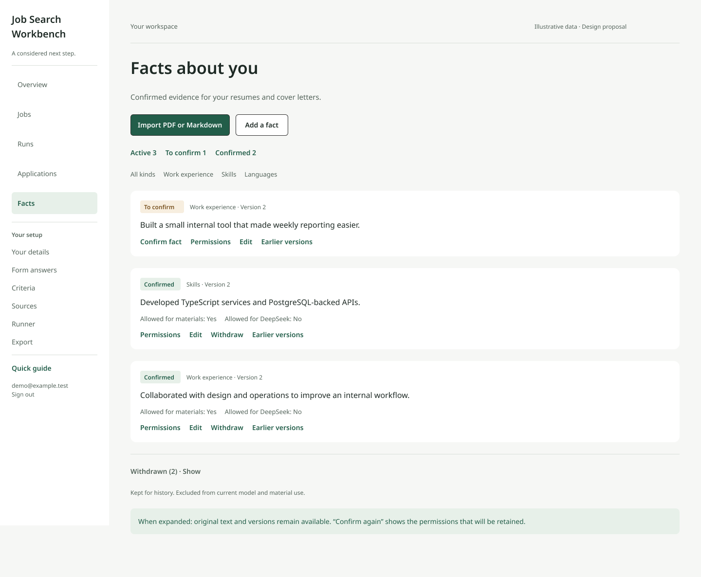
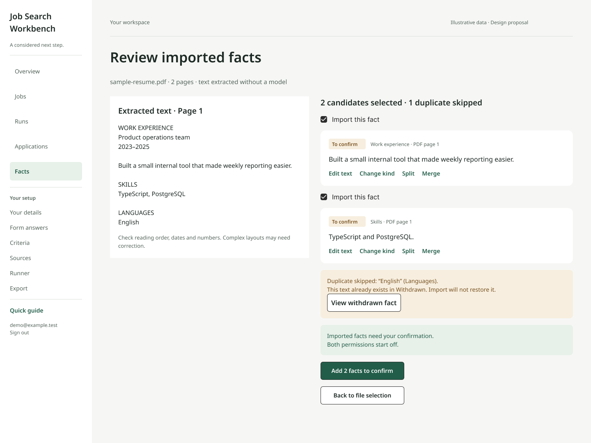

# UIUX 后续设计稿与实施说明

概念稿日期：2026-10-13。T24 补稿日期：2026-10-14。状态：**可编辑设计提案；2026-10-14 已完成 T22 的 Facts 局部状态修复与 T23 的 PDF/Markdown 共用候选审核，全站视觉与其他功能仍待实施**。本轮根据现有 Angular 页面和真实求职流程制作了 20 个画板；界面继续使用英文，说明与任务使用中文。所有姓名、公司、经历、职位、数字和文件均为编造示例。

[打开 Figma 完整设计稿](https://www.figma.com/design/63XwZ76x1rGxZhaRgqxbGs)。[开发任务 T22–T32](TASKS.md) 包含实现范围、依赖、验收和测试。静态预览保存在 [designs/](designs/)，可直接打开；Figma 内是可编辑文字、布局和控件实例，不是整页截图。

2026-10-14 T24 补稿见 [完整设计交付](T24_DESIGN_HANDOFF.md) 和 [离线审阅页](designs/t24/index.html)：28 个页面/场景覆盖全部现有路由及 Electron 工具栏，66 个关键动作各有五态，补齐各设置页、冻结申请详情及异常状态。用户于2026-10-15批准合并本补稿作为后续实现基准；本文件和 Figma 原有20画板保留为概念参考。

## 主要决定

- Facts 的当前有效事实与 Withdrawn 分离。待确认优先；已撤回统一放页面最末、默认折叠，并展示数量和保留原因。撤回成功立即移动，失败保留原位。
- 新增 PDF 导入，保留 Markdown 与手填。流程为选文件 → 提取文字 → 校对/分类/选择候选 → 加入待确认；导入不等于确认，也不授予模型或材料许可。
- 首次使用采用可跳过、可继续、可重看的三步简短教程。首页以真实的下一步为核心，不添加虚构统计；深链接登录后仍返回原页面。
- 主导航为 Overview / Jobs / Runs / Applications / Facts；Your details、Form answers、Criteria、Sources、Runner、Export 分组为 Your setup，保留原有路由。
- 日常界面采用安静的浅色工作台、森林绿操作色、明确的文字层级；同时保留深色主题。宽屏分区，窄屏单列，Electron 左侧 app pane 单独验收。

## Facts 与 PDF 的交互规范

`proposed` 显示 To confirm，`confirmed` 显示 Confirmed，`retired` 显示 Withdrawn。分区只看 current.status；Earlier versions 中的撤回状态不能影响当前有效事实。计数依当前筛选的真实数据，Withdrawn 不计入 Active。正常列表先分待确认/已确认，再按既有类型顺序、fact.createdAt 与 ID 稳定排列。

卡片先显示状态、正文，再显示用途、来源/版本和操作；Permissions 是两个许可的明确展开入口，proposed 版本默认两个许可关闭。“Allowed for materials / Allowed for DeepSeek” 表达资格，不能写成已经使用或已经发送。权限展开后提供两个独立控件，敏感内容的模型许可不可开启且给出原因。源文件名和页码不进入模型请求。

Withdrawn 展开保留正文和历史，弱化视觉而不降低可读性。Confirm again 沿用现有恢复行为：保留两个许可；操作前必须看见将保留的选择及恢复后的用途。Edit 产生新的 proposed 版本并关闭两个许可。已有匹配/草稿按当前证据规则失效，冻结申请仍保留当时引用。

PDF 首版复用现有 unpdf：**有文字层、最多 2 MiB、20 页**。扫描件不做 OCR，提示选择可复制文字的 PDF 或粘贴文本；损坏、加密、超限和无文字分别说明恢复方式。多栏/表格的阅读顺序可能有误，必须允许校对、拆分/合并、修改类别和取消候选；数字和日期不由模型改写。

预览没有事实写入。保存候选仍由服务端验证，整批写入保持原子性；新增事实全部 proposed、两个许可为 false。重复项按当前正文与本批候选判断；同文 Withdrawn 说明已存在并提供查看入口，**不自动恢复**。保存失败保留预览和用户修改。

## 首次使用与日常流程

1. **Add your experience**：解释导入、逐条确认和两个许可；真实入口为 Facts。
2. **Choose a job**：首要入口为粘贴 JD；配置来源、条件和预算作为可选的后续操作。
3. **Review before sending**：逐句读材料、核对实际表单读回与附件，每份申请单独批准。

教程只是说明，不创建样例资料、不调用模型、不签发令牌、不提交申请。最小持久化是按稳定账户 ID 与教程版本保存的本地状态；换设备、清理浏览器存储或换域名会再次出现。存储不可用仍可用产品；跳过后不反复弹出，帮助入口可重看。首页 checklist 根据实际数据计算，不以看过教程代替业务完成。

职位详情按 Source → Summary → Match → Materials → Form → Review 呈现阶段与阻塞原因，仍使用现有页面和组件。校验通过不等于语义正确，草稿仍逐句审查；陈述使用 Included / Checks passed 与 Edit statement / Leave out / View evidence，不能复用事实的 Withdraw 动作。模型动作旁保留付费 DeepSeek、选定内容外发及许可说明；外部 PDF 面试分支按每次准备单独授权。文档沿用 **浏览器打印保存 PDF，再上传核对文字**，稿件没有引入新的 PDF 生成能力。

表单预览先显示执行器实际读回的字段、附件和截图，再呈现单份批准。字段或附件变化时批准失效；验证码或 CAPTCHA 由用户在本地可见浏览器处理。To verify 不作为成功，也不自动重试。申请历史显示当时冻结的 JD、事实版本、文件和回执；当前草稿不能替换已发送文件。

## 画板、路由与任务对应

| 画板 | 现有路由/场景 | 任务 | 预览 |
| --- | --- | --- | --- |
| [01 Overview](https://www.figma.com/design/63XwZ76x1rGxZhaRgqxbGs?node-id=3-2) | `/` 下一步与 setup checklist | T26 | [图片](designs/overview.png) |
| [02 Facts](https://www.figma.com/design/63XwZ76x1rGxZhaRgqxbGs?node-id=3-3) | `/facts` 有效事实与末尾撤回区 | T22 | [图片](designs/facts-desktop.png) |
| [03 Import PDF](https://www.figma.com/design/63XwZ76x1rGxZhaRgqxbGs?node-id=3-4) | `/facts` 内导入审核，不新增必需路由 | T23 | [图片](designs/facts-import.png) |
| [04 First use](https://www.figma.com/design/63XwZ76x1rGxZhaRgqxbGs?node-id=3-5) | `/` / 应用内教程 | T26 | [图片](designs/onboarding.png) |
| [05 Jobs](https://www.figma.com/design/63XwZ76x1rGxZhaRgqxbGs?node-id=3-6) | `/jobs`；`/jobs/paste`、`/jobs/alerts` 继承表单规范 | T27 | [图片](designs/jobs.png) |
| [06 Job detail](https://www.figma.com/design/63XwZ76x1rGxZhaRgqxbGs?node-id=3-7) | `/jobs/:id` 阶段、引用与下一步 | T27 | [图片](designs/job-detail.png) |
| [07 Draft review](https://www.figma.com/design/63XwZ76x1rGxZhaRgqxbGs?node-id=3-8) | `/drafts/:id` 陈述与证据 | T28 | [图片](designs/draft-review.png) |
| [08 PDF preview](https://www.figma.com/design/63XwZ76x1rGxZhaRgqxbGs?node-id=3-9) | `/drafts/:id/document` 打印和上传 | T28 | [图片](designs/pdf-preview.png) |
| [09 Review and submit](https://www.figma.com/design/63XwZ76x1rGxZhaRgqxbGs?node-id=3-10) | `/jobs/:id` 实际表单与批准区域 | T28 | [图片](designs/review-submit.png) |
| [10 Applications](https://www.figma.com/design/63XwZ76x1rGxZhaRgqxbGs?node-id=3-11) | `/applications`、`/applications/:id` 列表和追溯结构 | T29 | [图片](designs/applications.png) |
| [11 Interview](https://www.figma.com/design/63XwZ76x1rGxZhaRgqxbGs?node-id=3-12) | `/applications/:id/interview` 练习与笔记 | T29 | [图片](designs/interview.png) |
| [12 Runs](https://www.figma.com/design/63XwZ76x1rGxZhaRgqxbGs?node-id=3-13) | `/runs` 预设/启动和预算 | T30 | [图片](designs/runs.png) |
| [13 Settings](https://www.figma.com/design/63XwZ76x1rGxZhaRgqxbGs?node-id=3-14) | `/profile`、`/answers`、`/criteria`、`/sources`、`/runner`、`/export` 统一表单/状态规则 | T30 | [图片](designs/settings.png) |
| [14 Sign in](https://www.figma.com/design/63XwZ76x1rGxZhaRgqxbGs?node-id=3-15) | `/login`；无业务导航 | T25–T26 | [图片](designs/login.png) |
| [15 Mobile](https://www.figma.com/design/63XwZ76x1rGxZhaRgqxbGs?node-id=3-16) | 390px Facts；紧凑导航 | T22/T25 | [图片](designs/facts-mobile.png) |
| [16 Electron pane](https://www.figma.com/design/63XwZ76x1rGxZhaRgqxbGs?node-id=3-17) | 605px app pane；右侧浏览器沿用现有行为 | T25 | [图片](designs/facts-electron.png) |
| [17 Dark](https://www.figma.com/design/63XwZ76x1rGxZhaRgqxbGs?node-id=3-18) | 深色 Facts 与状态 | T24–T25 | [图片](designs/facts-dark.png) |
| [18 Handoff](https://www.figma.com/design/63XwZ76x1rGxZhaRgqxbGs?node-id=3-19) | token、响应式与状态文案 | T24/T31 | [图片](designs/handoff.png) |
| [19 Withdrawn / Permissions](https://www.figma.com/design/63XwZ76x1rGxZhaRgqxbGs?node-id=6-173) | `/facts` 权限展开、撤回历史与恢复前说明 | T22 | [图片](designs/withdrawn-permissions.png) |
| [20 Import / Errors](https://www.figma.com/design/63XwZ76x1rGxZhaRgqxbGs?node-id=6-212) | `/facts` 选文件、读取和可恢复错误 | T23 | [图片](designs/import-errors.png) |

应用记录详情、设置各子页及关键异常状态现已在 [T24 补稿](T24_DESIGN_HANDOFF.md) 提供独立画板、地址和组件对应；用户已批准合并设计交付，后续仍需实现和运行时验收。未知路由页继承应用壳、标题、返回入口与错误规范。稿件上的文字操作在实现中必须成为真实 button/link，不能直接复制成一段不可操作文字。

## 视觉与响应式规格

| 语义 | 浅色 | 深色 |
| --- | --- | --- |
| 页面背景 | `#f6f7f5` | `#17231c` |
| 内容表面 | `#ffffff` | `#202d25` |
| 主文字 | `#1d2924` | `#eff5ef` |
| 次文字 | `#53635a` | `#b4c3b6` |
| 分隔线 | `#d9dfd9` | `#3b4c41` |
| 主操作色 | `#225d49` | `#a9d8b8` |
| 信息底色 | `#e7f0e9` | `#2b4032` |
| 待确认文字/底色 | `#77501e` / `#f7eedf` | `#f0cd8a` / `#3e3526` |

实现继续使用系统字体，避免为了稿件新增字体下载；Figma 用 Noto Sans 作为可编辑的近似，并复用 Simple Design System 控件实例。字号：正文 15–16px、次信息 12–14px、区块标题 19–21px、页面标题 28–34px。间距：8 / 12 / 16 / 24 / 32 / 44px；宽屏侧栏 224px，内容 padding 44px，窄屏 24px。控件最小约 44px 高，面板圆角 12px，普通操作圆角 6px。深色浅绿主按钮使用深色文字。

宽屏用分组侧栏；低于约 900px 使用紧凑菜单并将双栏顺序排为单列，优先保留当前任务。不要用屏幕总宽判断 Electron app pane：实际需检查 360px 和约 605px。Web 验收 1440/1024/768/390/360px，200% 缩放、长文本和键盘操作另测。A4 文档打印隐藏应用导航、教程和操作区，不能依赖旧 header/main 选择器仍然成立。

## 交付检查与后续门槛

独立审查查看了 20 张静态预览，并列出 8 类稿件修正；复核后这 8 类均已解决，结论为可交付的静态设计提案。这不等于所有页面状态审定或运行时验收完成。

已检查画板的文字/布局结构和静态截图；20 个画板使用可编辑层而非整页位图，主画板边界无文字溢出。静态稿没有接 API、文件读取、表单和真实投递逻辑，不能作为浏览器可访问性、交互和打印已经通过的证明。

T24 路由与状态补稿已交付并获用户合并批准；T25–T30 落地；T31 按加载/空态/失败/重试/保存/过期/待核实，及键盘、对比度、亮暗、手机、Electron、打印进行运行时验收。所用账户与 PDF 样本为编造数据，真实个人文件及提交沿用逐次授权规则。

Railway 拓扑调整由 T32 独立处理，见 [部署说明](DEPLOYMENT.md)。2026-10-19 的 T32.1 已核实生产无旧 staging 依赖及历史故障库指向；用户明确批准后已请求删除旧项目，平台排定 10 月 21 日 15:40（赫尔辛基）清除，生产身份、数据库与来源保留，保留服务另按用户要求开启闲置休眠，最终核验与下载边界详见 [维护记录](T32_MAINTENANCE.md)。
